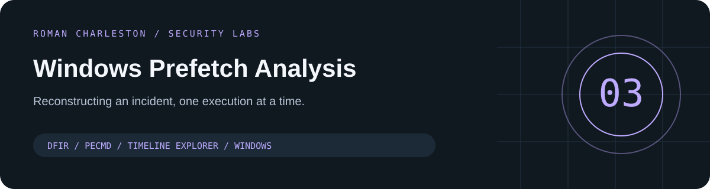
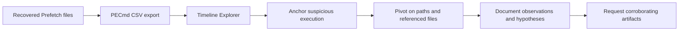

# Windows Prefetch Analysis · DFIR case study

**A completed home-lab investigation reconstructing suspicious program execution from Windows Prefetch artifacts.**

[Portfolio case study](https://grcengineer.io/projects/windows-prefetch-analysis/) · [Full Medium walkthrough](https://medium.com/@romancharleston/prefetch-analysis-home-lab-4c9e376c9e01) · [Investigation notes](analysis/prefetch-investigation.md) · [Command reference](commands/powershell-commands.md)

## The case

In a simulated incident, a fictional employee at Initech downloaded a supposed cracked copy of BurpSuite. I used **PECmd** and **Timeline Explorer** to examine execution times, referenced paths, and nearby activity in recovered Prefetch files.

The useful outcome is a defensible timeline and a set of hypotheses to test with additional evidence—not a claim that Prefetch alone proves every stage of compromise.

## Follow the evidence

| Reviewer path | What it demonstrates |
|---|---|
| [Investigation walkthrough](analysis/prefetch-investigation.md) | Scoping, pivots, and confidence limits |
| [Selected observations](analysis/selected-observations.csv) | Source-backed timestamps with explicit timestamp meaning |
| [PECmd commands](commands/powershell-commands.md) | Practical, readable tool usage |
| [Original article](https://medium.com/@romancharleston/prefetch-analysis-home-lab-4c9e376c9e01) | Detailed screenshots and the full learning narrative |

## Key observations

- The suspicious executable ran at **2024-03-12 18:36:11**, as reported in the source analysis.
- Short executable names under `Windows\Temp` and overlapping referenced files warranted additional investigation.
- Rclone and a later `SD.EXE` run referenced a common staging directory; exfiltration and cleanup remain hypotheses without supporting artifacts.
- A DLL reference or tool name is a lead, not proof of malicious intent.

## Reproduce the analysis workflow

Use your own authorized evidence and obtain PECmd / Timeline Explorer from [Eric Zimmerman's official tools page](https://ericzimmerman.github.io/). Preserve originals and work from copies. The command reference exports CSVs for analysis; no malware or original evidence bundle is distributed here.

**Credit:** this lab follows an exercise by **Eric Capuano**, introduced through the Simply Cyber community. The source scenario and evidence are credited in [DISCLAIMER.md](DISCLAIMER.md). The analysis and write-up presented here are Roman Charleston's learning work.
